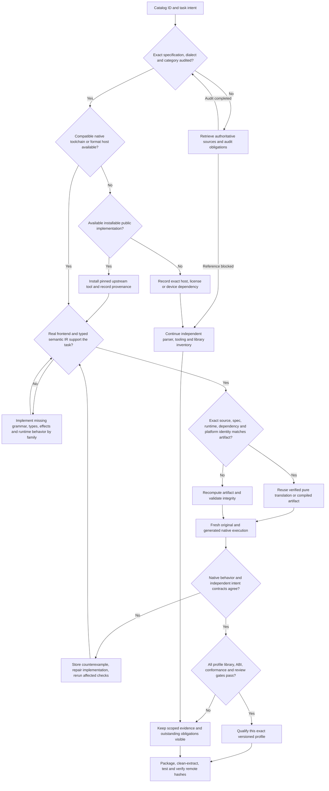

# Follow-through decisions

Every catalog ID retains its own obligations. Family sharing reduces compatible
engineering work; it cannot transfer an unproved semantic guarantee. A blocked
native host does not block independent source/grammar/specification work.

The executable `followthrough.usl` runs the available branch: plan all 606 entries,
benchmark actual typed Python-to-JavaScript translation and fresh executions,
invoke existing native success-collapse, verify N/M factored integer work and
H0/H1/H2 updates, then losslessly collapse all evidence available before that
step into verified CAS. Final summary fields are stored separately to avoid
self-reference. 604 entries still lack typed source-translation profiles;
non-executable formats require category-appropriate processing contracts.

Optimization decisions are calibrated before the new heldout workload. Use
measured CPU time, wall time, and cache bytes; select minimum declared cost and
record Pareto alternatives. If parallel or factored execution is slower, retain
the sequential route. Exact artifacts may be reused; execution evidence and
external side effects are never replayed from a cache.

All available equation records are inventoried. Scheduling, exactness, cost,
fairness, compression, work avoidance and partial-update mechanisms are applied
to measured data. Amdahl is an explicitly optimistic bound. Physics, quantum,
finance and other models require their own measured inputs and appropriate tasks;
registry default numbers are not workload measurements.
